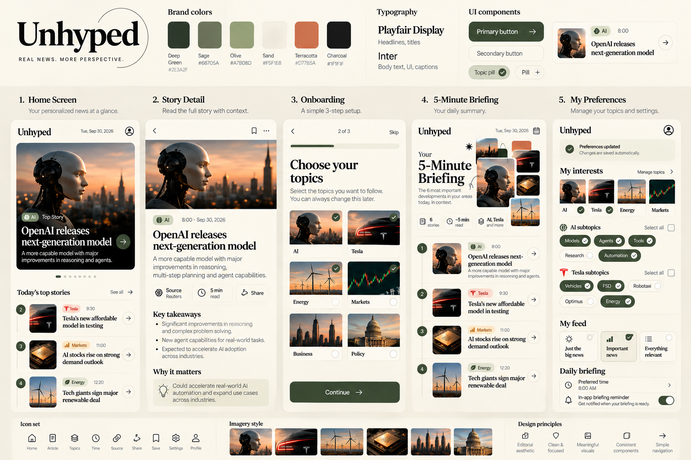
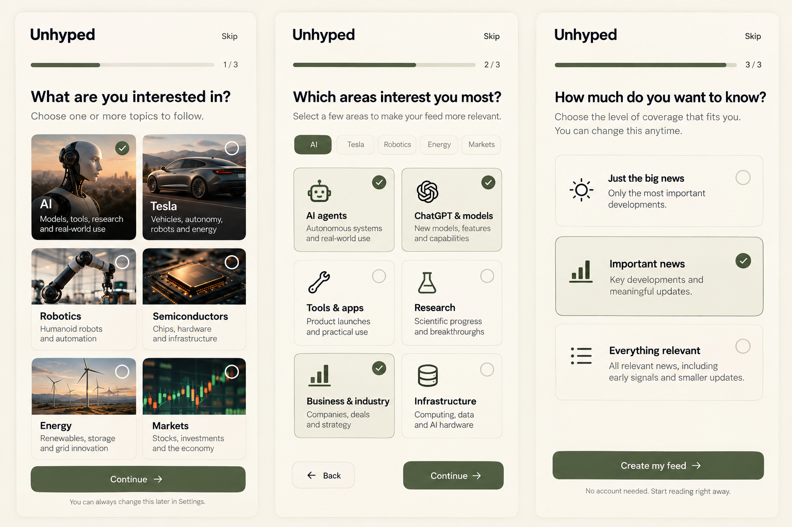
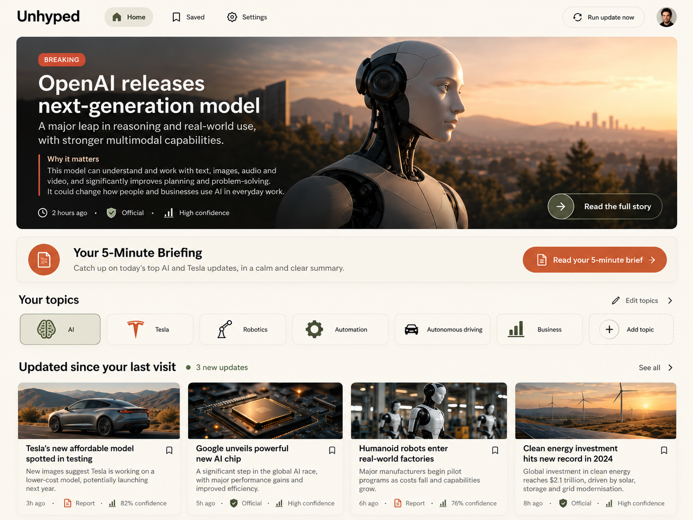
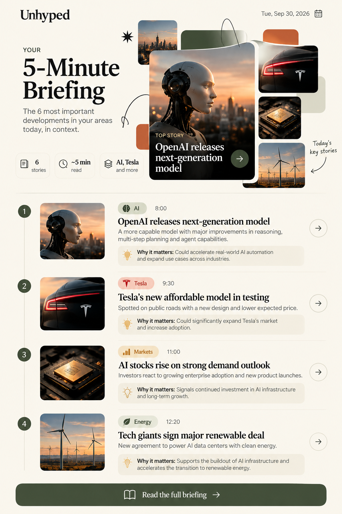
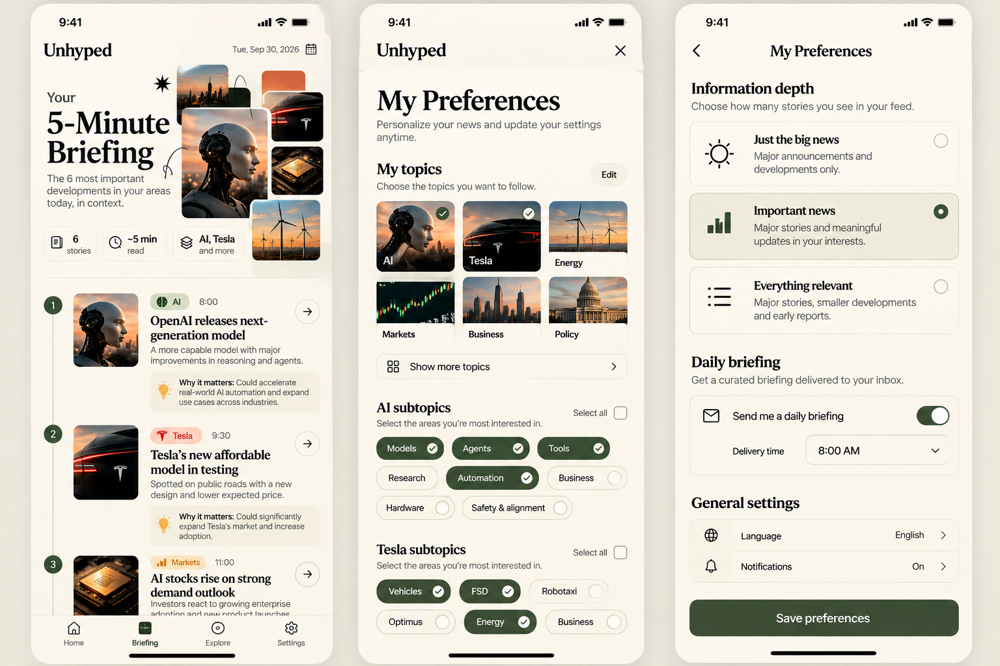
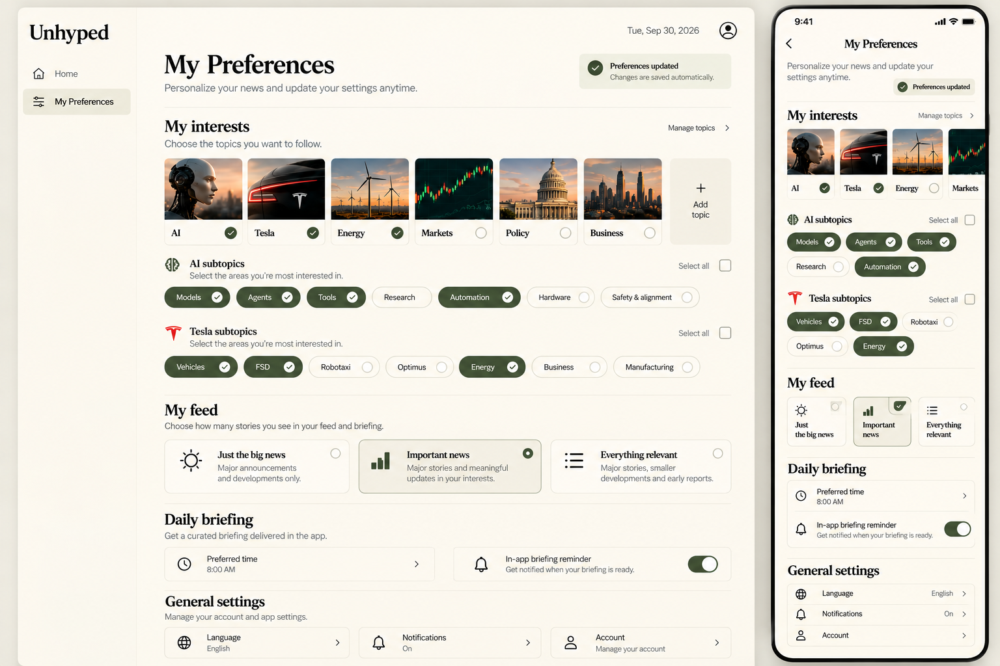

# DESIGN: Unhyped

> נכתב ב-11/11/2026 לפי המוקאפים של אורי (09/11/2026) והאתר הבנוי. אין עדיין Wireframes נפרדים: המוקאפים משמשים גם למבנה.

## תמונות הייחוס

## 1. Screens

### Onboarding
- המטרה: להתאים את הפיד ב-10 שניות, בלי הרשמה.
- מה יש במסך: פס התקדמות ו-Skip. שלב 1: "What are you interested in?" עם כרטיסי תמונה גדולים ל-AI ול-Tesla. שלב 2: "How much do you want to know?" עם שלוש אפשרויות: Just the big news / Important news / Everything relevant. כפתור ירוק כהה "Create my feed". טקסט קטן: "No account needed".
- מה קורה במסך: הבחירה נשמרת במכשיר ומעבירה ל-Home.
- הערה: במוקאפ יש 3 שלבים (כולל תת־תחומים) ו-6 נושאים. בנוי: 2 שלבים ו-2 נושאים, לפי החלטת אורי.

### Home
- המטרה: לראות במבט אחד מה חשוב היום.
- מה יש במסך: ידיעה ראשית גדולה עם תמונה, תווית ו-Why it matters. באנר "Your 5-Minute Briefing" עם כפתור טרקוטה. Must know today ממוספר. שורות אופקיות של כרטיסים (Trending, לפי נושא). בכל כרטיס: תמונה, כותרת, שורה, זמן, תווית. בסוף: "You're all caught up."
- מה קורה במסך: לחיצה על כרטיס פותחת Story. לחיצה על הבאנר פותחת Brief.

### Story
- המטרה: להבין אירוע אחד לעומק, עם מקורות.
- מה יש במסך: תמונה, תווית והסבר שלה, כותרת Playfair, dek, Key takeaways, Why it matters (קופסה), What happened, רשימת מקורות ומספר הכתבות שאוחדו. בטסלה: How the market reacted ושורת "no buy or sell advice". כפתורי Save ו-Share.
- מה קורה במסך: שמירה, שיתוף, חזרה.

### Brief (5-Minute Briefing)
- המטרה: להתעדכן בכל מה שחשוב היום ב-5 דקות ולסגור.
- מה יש במסך: כותרת גדולה "5-Minute Briefing", מספר סיפורים וזמן קריאה, קולאז' תמונות. רשימה ממוספרת עם קו זמן: תמונה, תג נושא, שעה, כותרת, שורה ו-Why it matters בקופסה צהבהבה. בסוף: "That's everything".
- מה קורה במסך: לחיצה על סיפור פותחת Story.

### Saved
- המטרה: לחזור לסיפורים ששמרתי.
- מה יש במסך: רשימת כרטיסים של סיפורים שמורים, או מצב ריק.
- מה קורה במסך: פתיחת סיפור, הסרה משמורים.

### Preferences (Settings)
- המטרה: לשנות נושאים, עומק ותדריך.
- מה יש במסך: My interests (כרטיסי נושא), My feed (שלוש רמות עומק), Daily briefing (שעה, תזכורת), General settings.
- מה קורה במסך: השינוי נשמר מיד ומשנה את הפיד.

### Editor (כלי פנימי)
- המטרה: לאשר סיפורים חשובים לפני פרסום.
- מה יש במסך: כניסה במייל. "Waiting for review" עם כרטיס לכל סיפור: תווית, ציון, מספר כתבות, כותרת, dek, takeaways, קישורים למקורות, וכפתורים Approve / Edit title / Reject. מתחת: "Recently published" עם Unpublish.
- מה קורה במסך: כל פעולה מעדכנת את הסיפור מיד, והפיד מתרענן.
- הערה: אין למסך הזה מוקאפ. הוא בנוי באותה שפה עיצובית.

### ניווט בין המסכים
- סרגל ניווט עם ארבעה יעדים: Home, Briefing, Saved, Settings. בטלפון הוא למטה, במחשב למעלה.
- Onboarding מופיע רק בכניסה הראשונה. Editor נגיש רק מהכתובת `#/editor`.

## 2. Style Guide

### צבעים
| שם | HEX | שימוש |
|---|---|---|
| Sand | `#F5F1E8` | רקע ראשי (60%) |
| Deep green (forest) | `#2E3A2F` | כפתורים ראשיים, כותרות, סרגלים (30%) |
| Sage | `#66705A` | טקסט משני, תגיות |
| Olive | `#A7B08D` | הדגשות עדינות |
| Terracotta | `#D77B5A` | קריאה לפעולה ותגית Breaking (10%) |
| Charcoal | `#1F1F1F` | טקסט ראשי |
| Honey | `#C99A2E` | רקע Why it matters ושמועות |

### גופנים
- כותרות: **Playfair Display** (500–700).
- טקסט, כפתורים ותוויות: **Inter** (400–600).

### כפתורים ורכיבים
- כפתור ראשי: ירוק כהה, טקסט לבן, פינות מעוגלות מלאות.
- כפתור משני: מסגרת דקה על רקע חול.
- תווית אמינות: גלולה קטנה עם אייקון ומילה (Official / Report / Rumor).
- כרטיס: רקע בהיר, פינות מעוגלות, צל רך מאוד.
- קופסת Why it matters: רקע צהבהב-חול עם אייקון.

### פינות, צורות ומרווחים
- פינות מעוגלות גדולות בכרטיסים ובתמונות (בערך 16–24px).
- מרווחים נדיבים. אין קווים מפרידים כבדים.
- צל אחד רך לכל הכרטיסים.

### אווירה כללית
רגועה, חמה ובוגרת, כמו מגזין. צילומי שקיעה חמים (רובוטים, טסלה, שבבים, טורבינות רוח). בלי אדום צועק, בלי אנימציות לחוצות, בלי סימני קריאה.
